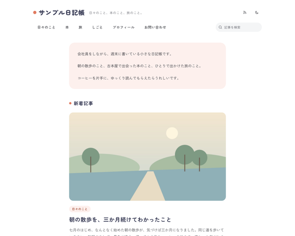

# BcBlogEssaySoftTheme

baserCMS5用の、エッセイ・コラム・日記など長い文章を読んでもらうための、個人ブログのテーマです。

白地に、メインの色を薄めたやわらかい差し色と、丸みのある見出しを組み合わせた、親しみやすい日記帳のような見た目です。写真や引用・箇条書きの箱は角を丸くしています。



エッセイのブログテーマは2種類あります。仕組みと機能は同じで、見た目だけが違います。

| テーマ | 見た目 |
|---|---|
| BcBlogEssayLiteraryTheme | 文芸：生成りの地に明朝の見出しと本文。段落の字下げ、傍点、「＊」の区切り |
| BcBlogEssaySoftTheme | やわらかい：白地にパステルの差し色、丸ゴシックの見出し、角の丸い写真と箱 |

## 主な機能

- 1カラム：サイドバーを置かず、本文の幅は1行 34〜38 文字程度
- 記事の詳細
  - 読了時間の目安（本文の文字数から計算）、投稿日・更新日、カテゴリ・タグ
  - 書き手のプロフィール（写真・名前・ひとこと・SNS）を本文の下に大きく
  - シェア（X・はてなブックマーク・Facebook・LINE・Feedly・RSS）は本文の下に1か所、前後の記事、関連記事（同じタグの記事）、コメント
- 一覧：1列で、全件同じ形。アイキャッチがない記事は画像の場所を出さず、文字だけの形になる（本文に画像があれば、最初の画像を使う）
- フッター：書き手の短いプロフィールとナビ
- ライト／ダークの切り替え（配色モードと切り替えボタンの有無は、テーマ設定で選べる）
- 本文：BurgerEditor のブロックでも、通常のエディタの HTML でも同じ見た目。引用、画像とキャプション、場面の区切り（hr）、表、補足の囲み（「ポイント」「注意」）
- お問い合わせフォーム（入力 → 確認 → 完了）、サイト内検索の結果画面、パンくず（構造化データつき）、印刷用の CSS（本文だけを印刷）
- テーマ設定の4色で配色を変えられる（どの色でも、文字が読める明るさに自動で調整する）
- jQuery に頼らない JS（BurgerEditor の公開側スクリプトとコメントの送信のために jQuery は読み込む）

## 動作環境

- baserCMS5.4以上
- BurgerEditor（BcBurgerEditor）：なくても使えます（通常のエディタで書いた本文にも対応）
- 対応ブラウザ：最新の Chrome・Edge・Safari・Firefox（CSS のコンテナクエリ・`:has()`・`color-mix()` を使っています）

## インストール

1. このリポジトリの Releases から ZIP をダウンロードし、管理画面の「テーマ管理」→「新しいテーマを追加」でアップロードする（または `plugins/BcBlogEssaySoftTheme/` に置く）
2. 「テーマ管理」で BcBlogEssaySoftTheme を適用する
3. 見本のデータを入れるときは、初期データ「default」を読み込む（空の状態から始めるときは「empty」、ページ送りなどを確かめるときは記事が40本入った「test」）

> 初期データを読み込むと、ユーザー以外のデータ（固定ページ・ブログ・ウィジェットなど）は初期化されます。運用中のサイトでは読み込まないでください。

## 使い方

### 編集できる場所

| 内容 | 編集する場所 |
|---|---|
| サイト名 | サイト管理 →「サイトタイトル」 |
| ヘッダーの説明1行・ブログのトップの紹介文 | ブログ設定 →「ブログ説明文」（ヘッダーには最初の1文が出る） |
| トップページの紹介文 | 固定ページ「index」の本文 |
| ヘッダー・フッターのナビ | テーマ設定の「ヘッダーのナビ」で選ぶ。初期値は「ブログのカテゴリ＋固定ページなど」（最初のブログのカテゴリ＋ルート直下の固定ページ・メールフォーム・リンク。「メニューに表示しない」を除く） |
| ロゴ・配色（4色）・配色モード・切り替えボタン | テーマ設定 |
| 記事の下の書き手のプロフィール | ウィジェットエリア「記事の下：著者」のテキストのウィジェット |
| フッターの書き手のプロフィール | ウィジェットエリア「フッター：プロフィール」のテキストのウィジェット（空なら、サイト名と説明1行が出る） |
| プロフィールのページ | 固定ページ「profile」 |
| サイドバー | ウィジェットエリア「サイドバー」。初期データでは空（ウィジェットを入れると、本文の下に出る） |
| 広告 | ウィジェットエリア「広告：記事の上」「広告：記事の下」「広告：一覧の途中」にテキストのウィジェットで広告のコードを貼る（「タイトルを表示」はオフ） |
| 一覧の件数・コメントの受け付け | ブログ設定 |

書き手のプロフィールの写真は、テキストのウィジェットの `<span class="bt-avatar"></span>` の画像を差し替えます（初期データの見本を参照）。

### 本文の書き方

- 見出しは h2・h3 を使う
- 場面の区切りは、区切り線（hr）を入れる（「・・・」の飾りで出る）
- 引用：本や人の言葉を引くときは引用（blockquote）。最後の段落を「―― 出典」にすると、右寄せの小さな文字になる
- 補足の囲み：引用（blockquote）の最初の段落を、太字だけの1行にする

```html
<blockquote><p><strong>ポイント</strong></p><p>本文…</p></blockquote>
```

## 設定

### 配色モード

テーマ設定の「配色モード」「ライト／ダークの切り替えボタン」で選べます。テーマ設定を保存していないときは、`config/setting.php` の `colorScheme`（`auto`／`light`／`dark`）と `schemeToggle`（`true`／`false`）が使われます。

- 切り替えボタンを表示するとき：閲覧者が選んだ配色が優先されます
- 切り替えボタンを表示しないとき：配色モードの配色に固定されます（「OS の設定に合わせる」なら OS に従います）

### そのほかの設定（`config/setting.php`）

| キー | 初期値 | 内容 |
|---|---|---|
| `toc` | `false` | 記事の目次を出す（`true` にすると、本文の上に開閉できる目次が出る） |
| `shareTop` | `false` | 記事の上にもシェアを出す |
| `thumbFallback` | `none` | アイキャッチも本文の画像もない記事のカード。`frame` にすると「色の枠＋カテゴリ名」を出す |
| `dateFormat` | `Y年n月j日` | カード・記事の日付の書式（PHP の date の書式） |

### ウィジェットエリアを自分のサイトに足すとき

初期データを使わずにテーマだけを適用したときは、ウィジェットエリアを「記事の下：著者」「フッター：プロフィール」「広告：記事の上」「広告：記事の下」「広告：一覧の途中」の名前で作ると、その場所に表示されます（名前で探しています）。

## 制限事項

- アイキャッチの見本画像は、初期データでは入りません（baserCMS の初期データは画像ファイルをコピーしないため）。見本の記事は、本文の最初の画像をカードに使っています
- カテゴリの説明文は表示しません（baserCMS5 のブログのカテゴリに説明文の項目がないため）
- 初期データを読み込むと、記事の投稿日は見本の日付に戻ります（BcBlog は読み込み時にすべての投稿日を「今」にするため、テーマで戻しています）
- サイト内検索の索引は、初期データに同梱しています。記事を追加・編集すると、索引は自動で更新されます

## 同梱物・外部リソース

| 名前 | 用途 | ライセンス |
|---|---|---|
| [jQuery](https://jquery.com/) 3.7.1（`webroot/js/vendor/`） | BurgerEditor の公開側スクリプトと、ブログのコメントの送信に必要 | MIT |
| [Google Fonts](https://fonts.google.com/)（Zen Maru Gothic・Zen Kaku Gothic New） | 見出し・本文のフォント（CDN から読み込み。同梱はしていない） | SIL Open Font License 1.1 |
| アイコン（`templates/element/icons.php` の SVG） | ヘッダー・シェア・日付などのアイコン | このテーマの一部（MIT） |
| 見本画像（`webroot/img/sample/`） | 見本の記事・書き手の画像（文字を含まない図だけの画像） | このテーマの一部（MIT） |

## ライセンス

MIT License（[LICENSE](LICENSE)）
